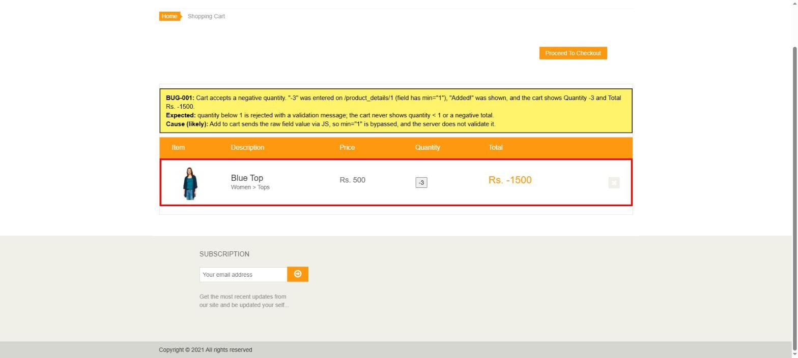

# BUG-001: Cart accepts zero and negative quantity, line total becomes negative

| Field | Value |
|---|---|
| **ID** | BUG-001 |
| **Module** | Product details → Cart |
| **Severity** | High |
| **Priority** | P1 |
| **Status** | Open |
| **Found** | 2026-11-05 |
| **Environment** | https://automationexercise.com · Windows 11 · Chrome (latest stable) · 1920×1080 |
| **Related test cases** | [TC-CART-04](../test-cases/TC-03-cart.md), [TC-CART-05](../test-cases/TC-03-cart.md) |

## Summary

On the product page the Quantity field has `min="1"`, but Add to cart accepts `0` and negative numbers. The product is added and the cart shows a zero or negative quantity and a negative line total (e.g. qty −3 → **Rs. -1500**).

## Preconditions

Cart is empty. User may be logged out.

## Steps to reproduce

1. Open https://automationexercise.com/product_details/1 (Blue Top, Rs. 500).
2. Clear the Quantity field and type `-3`.
3. Click **Add to cart**.
4. In the "Added!" modal click **View Cart**.

## Expected result

- Quantity below 1 is rejected with a validation message, and nothing is added to the cart.
- The cart never contains a line with quantity below 1 or a negative total.

## Actual result

- "Added!" modal is shown.
- Cart shows Blue Top with Quantity **-3** and Total **Rs. -1500**.
- With quantity `0` the cart shows Quantity **0**, Total **Rs. 0**.

## Evidence

## Root cause (analysis)

The quantity value is sent by JavaScript straight to the add-to-cart request. The browser `min="1"` constraint is only enforced on native form submit, so it is bypassed, and the server does not validate the value either.

## Impact

Wrong cart totals. If the cart total feeds the order total, a negative line could reduce the price of other items in the same order. Must be validated on both client and server.

## Notes

- Reproduced with `-3` and with `0`; valid quantity `4` gives the correct line total (Rs. 2000).
- Checkout with such a cart was not executed (needs a logged-in account); see [TC-CHK-04](../test-cases/TC-04-checkout.md).
