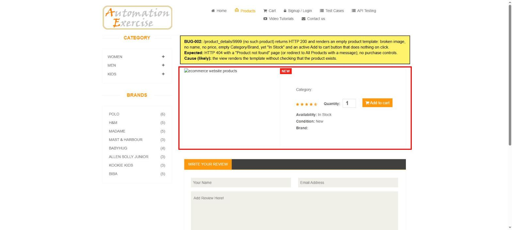

# BUG-002: Non-existent product id opens an empty product page (HTTP 200) with a dead Add to cart button

| Field | Value |
|---|---|
| **ID** | BUG-002 |
| **Module** | Catalog → Product details |
| **Severity** | Medium |
| **Priority** | P2 |
| **Status** | Open |
| **Found** | 2026-11-05 |
| **Environment** | https://automationexercise.com · Windows 11 · Chrome (latest stable) · 1920×1080 |
| **Related test cases** | [TC-CAT-05](../test-cases/TC-02-catalog-search.md) |

## Summary

Opening a product URL with an id that does not exist (e.g. `/product_details/9999`) returns **HTTP 200** and renders a product template with no data: broken image, no name, no price, empty Category and Brand, but "Availability: In Stock" and an active **Add to cart** button that does nothing when clicked.

## Preconditions

None.

## Steps to reproduce

1. Open https://automationexercise.com/product_details/9999
2. Look at the product block.
3. Click **Add to cart**.
4. In DevTools → Network, check the status of the document request.

## Expected result

- HTTP **404** and a "Product not found" page (or redirect to All Products with a message).
- No purchase controls for a product that does not exist.

## Actual result

- HTTP **200**, page title "Automation Exercise - Product Details".
- Broken image, empty name / price / category / brand.
- "Availability: In Stock" and "Condition: New" are still shown.
- Add to cart gives no feedback: no modal, no error, nothing added to the cart.

## Evidence

## Impact

Old or mistyped product links (e.g. from ads, emails or search engines after a product is removed) show a broken page instead of a clear message. Search engines may index the empty pages because they return 200 ("soft 404").

## Notes

- `/product_details/abc` correctly returns 404, so only numeric unknown ids are affected.
- Same pattern for categories: `/category_products/999` returns 200 with an empty list and the broken heading "-  Products".
- Any unknown path (e.g. `/nonexistent-page`) returns the home page with HTTP 200 instead of 404.
