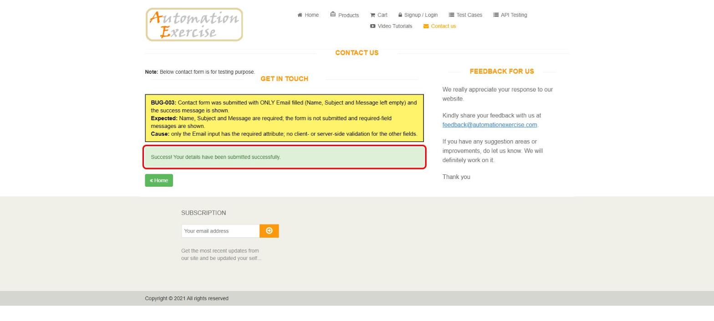

# BUG-003: Contact form is submitted successfully with empty Name, Subject and Message

| Field | Value |
|---|---|
| **ID** | BUG-003 |
| **Module** | Contact Us |
| **Severity** | Medium |
| **Priority** | P2 |
| **Status** | Open |
| **Found** | 2026-11-05 |
| **Environment** | https://automationexercise.com · Windows 11 · Chrome (latest stable) · 1920×1080 |
| **Related test cases** | [TC-CNT-04](../test-cases/TC-05-contact-form.md) |

## Summary

Only Email is required on the Contact Us form. A request with empty Name, Subject and Message is accepted and the user sees "Success! Your details have been submitted successfully."

## Preconditions

None.

## Steps to reproduce

1. Open https://automationexercise.com/contact_us
2. Leave Name, Subject and Message empty.
3. Enter Email `qa.portfolio.test@example.com`.
4. Click **Submit** and confirm the dialog with **OK**.

## Expected result

The form is not submitted. Name, Subject and Message show required-field messages: a contact request without a message has no content for support to act on.

## Actual result

Green message "Success! Your details have been submitted successfully." The empty request is accepted.

## Evidence

## Root cause (analysis)

In the page HTML only the Email input has the `required` attribute. Name, Subject and Message have no client-side or server-side validation.

## Impact

Empty requests reach the support inbox; spam bots can submit the form with only an email.
