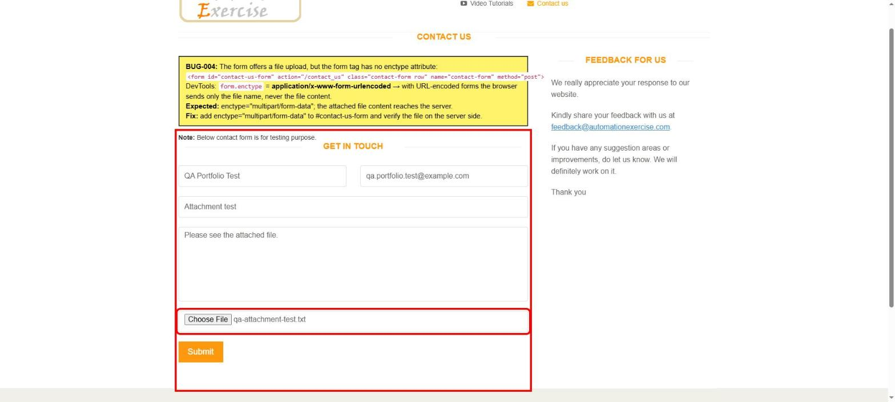

# BUG-004: Contact form attachment is never sent: form is missing `enctype="multipart/form-data"`

| Field | Value |
|---|---|
| **ID** | BUG-004 |
| **Module** | Contact Us |
| **Severity** | Medium |
| **Priority** | P2 |
| **Status** | Open |
| **Found** | 2026-11-05 |
| **Environment** | https://automationexercise.com · Windows 11 · Chrome (latest stable) · 1920×1080 |
| **Related test cases** | [TC-CNT-05](../test-cases/TC-05-contact-form.md) |

## Summary

The Contact Us form offers a file upload field, but the `<form>` element has no `enctype` attribute, so the browser submits it as `application/x-www-form-urlencoded`. With this encoding only the file **name** is sent, never the file content. The user sees the success message and believes the file was delivered.

## Preconditions

None.

## Steps to reproduce

1. Open https://automationexercise.com/contact_us
2. Open DevTools → Elements and select `<form id="contact-us-form">`.
3. Check the attributes of the form; in the Console run `document.querySelector('#contact-us-form').enctype`.
4. Fill all fields, choose a small text file in the upload field, click **Submit**, confirm **OK**.
5. In DevTools → Network open the POST request to `/contact_us` and check the request Content-Type and payload.

## Expected result

- The form uses `enctype="multipart/form-data"`.
- The request Content-Type is `multipart/form-data` and the payload contains the file content.

## Actual result

- `<form>` has no `enctype` attribute; `form.enctype` returns `application/x-www-form-urlencoded`.
- Under the HTML standard a URL-encoded form sends only the file name for a file input, so `upload_file` carries the name and no content.
- Success message is shown anyway.

## Evidence

## Fix suggestion

Add `enctype="multipart/form-data"` to `<form id="contact-us-form">` and check on the server that the file is received.

## Notes

- No file type or size limits are shown or enforced on the upload field (no `accept` attribute, no message).
