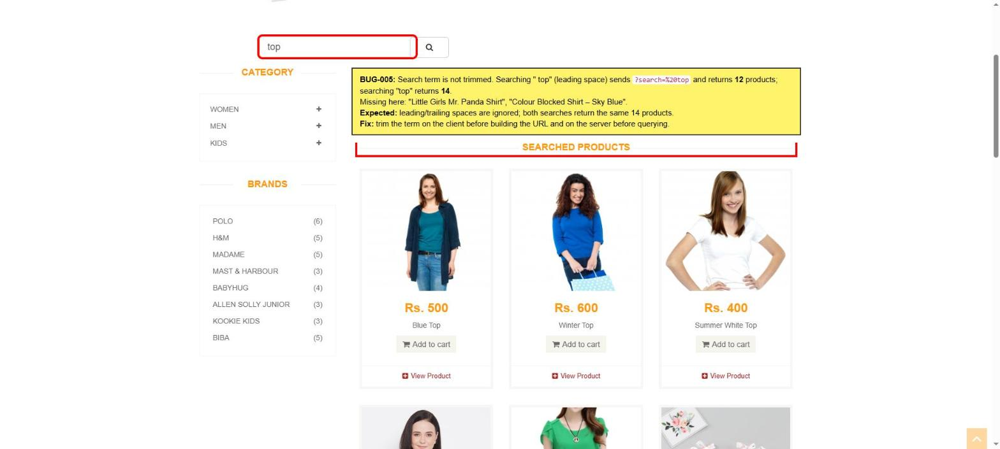

# BUG-005: Product search does not trim leading spaces: " top" returns fewer results than "top"

| Field | Value |
|---|---|
| **ID** | BUG-005 |
| **Module** | Catalog → Search |
| **Severity** | Low |
| **Priority** | P3 |
| **Status** | Open |
| **Found** | 2026-11-05 |
| **Environment** | https://automationexercise.com · Windows 11 · Chrome (latest stable) · 1920×1080 |
| **Related test cases** | [TC-SRCH-03](../test-cases/TC-02-catalog-search.md), [TC-SRCH-04](../test-cases/TC-02-catalog-search.md) |

## Summary

A leading space in the search field is sent as part of the query (`/products?search=%20top`) and changes the results. Searching `top` returns 14 products, searching ` top` (space before) returns 12. A leading space often comes from copy-paste or mobile keyboards.

## Preconditions

None.

## Steps to reproduce

1. Open https://automationexercise.com/products
2. Type `top` in Search Product, click search. Count the results.
3. Clear the field, type ` top` (one space, then `top`), click search. Count the results.

## Expected result

Leading and trailing spaces are ignored; both searches return the same 14 products.

## Actual result

- `top` → 14 products.
- ` top` → 12 products. URL contains `search=%20top`.
- Missing: "Little Girls Mr. Panda Shirt", "Colour Blocked Shirt – Sky Blue".

## Evidence

## Fix suggestion

Trim the search term on the client before building the URL and again on the server before querying.

## Notes

- A search with no matches (e.g. `xyzqwe`) shows only the "Searched Products" title and an empty area, with no "No products found" message. Logged as a usability improvement.
- `top blue` returns 0 results while `blue top` returns Blue Top: search matches the exact phrase only. Improvement, not a defect.
